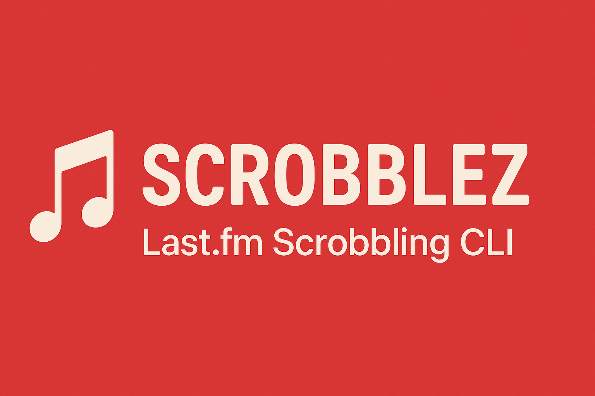
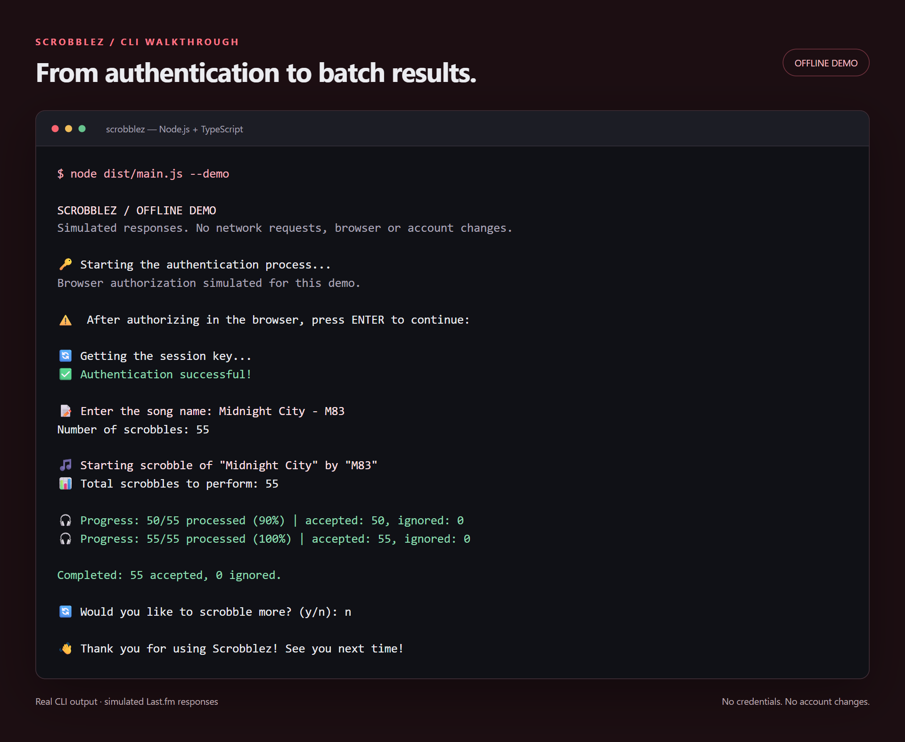
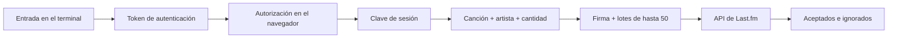

<p align="center">
  <a href="README.md">English</a> · <a href="README.pt-BR.md">Português (Brasil)</a> · <strong>Español (España)</strong>
</p>

<p align="center">
  
</p>

<h1 align="center">Scrobblez</h1>
<p align="center">Una CLI en TypeScript para explorar la autenticación y el envío de scrobbles por lotes con la API de Last.fm.</p>

<p align="center">
  <a href="https://github.com/mwistro/Scrobblez/actions/workflows/ci.yml"></a>
  
  
  <a href="LICENSE"></a>
</p>

<p align="center">
  <a href="#demostración">Demostración</a> · <a href="#ejecución-local">Ejecución local</a> · <a href="#cómo-funciona">Cómo funciona</a> · <a href="#alcance-actual">Alcance actual</a>
</p>

## Vista general

Scrobblez es un proyecto de aprendizaje sobre la integración con API desde el terminal. El flujo reúne autorización en el navegador, firma de peticiones, entrada interactiva y seguimiento de los resultados de cada lote.

Un *scrobble* es un registro de reproducción enviado a Last.fm. Este proyecto utiliza entradas manuales y marcas de tiempo generadas; no detecta qué se está reproduciendo. La demostración sin conexión permite probar el flujo sin utilizar una cuenta.

| Función | Implementación |
| --- | --- |
| Autenticación | Solicita un token, abre la autorización en el navegador y obtiene una sesión. |
| Entrada interactiva | Acepta `canción - artista` o solicita el artista por separado. |
| Envío por lotes | Divide la cantidad indicada en peticiones de hasta 50 registros. |
| Resultados visibles | Muestra el progreso y las cantidades de registros aceptados e ignorados por separado. |
| Demo sin conexión | Ejecuta el mismo flujo con respuestas simuladas, sin red ni credenciales. |

## Demostración



*Vista renderizada a partir de la salida real del modo demo. Las respuestas de Last.fm están simuladas: no se ha enviado ningún scrobble. La interfaz del terminal está en inglés.*

La demo utiliza `Midnight City - M83` y 55 registros ficticios para mostrar la división en dos lotes: 50 + 5. Consulta la [salida completa en texto](docs/assets/demo.txt).

## Ejecución local

### Probar sin una cuenta

Requisitos: **Node.js 22 o superior**, npm y Git. La integración continua comprueba las versiones 22 y 24 de Node.js.

```bash
git clone https://github.com/mwistro/Scrobblez.git
cd Scrobblez
npm ci
npm run demo
```

Este comando compila TypeScript y ejecuta una sesión de demostración. No lee el archivo `.env`, no abre el navegador ni realiza peticiones de red. La instalación de dependencias requiere conexión a internet.

### Conectar con Last.fm

El modo conectado envía registros a tu cuenta. La implementación actual genera marcas de tiempo a intervalos de cinco minutos hacia atrás desde el momento de la ejecución; no recupera las horas reales de reproducción. Consulta el [alcance actual](#alcance-actual) antes de utilizar este modo.

1. Crea tus credenciales en la [página de aplicaciones de Last.fm](https://www.last.fm/api/account/create).
2. Copia [`.env.example`](.env.example) a `.env` **en la raíz del repositorio** y rellena ambos campos:

   ```dotenv
   LASTFM_API_KEY=your_api_key
   LASTFM_SHARED_SECRET=your_shared_secret
   ```

3. Compila y ejecuta desde la raíz:

   ```bash
   npm run build
   npm start
   ```

4. Autoriza la aplicación en el navegador y vuelve al terminal para pulsar Intro.
5. Introduce `canción - artista` (con espacios alrededor del guion), o solo la canción para que se te solicite el artista. Después, indica una cantidad entera positiva.
6. Comprueba los resultados. Responde `y` para continuar o `n` para salir.

Git ignora el archivo `.env`. La sesión se mantiene solo en memoria; cada nueva ejecución requiere autorización.

## Cómo funciona



Las peticiones se firman con el secreto compartido. El envío utiliza `POST` con datos de formulario; el resumen lee las cantidades devueltas por la API. Referencias: [autenticación de escritorio](https://www.last.fm/api/desktopauth) y [`track.scrobble`](https://www.last.fm/api/show/track.scrobble).

En la demo, las respuestas y las entradas están predefinidas y se desactiva la apertura del navegador. El resto del flujo sigue utilizando las funciones de la CLI.

## Tecnologías y estructura

| Capa | Tecnología |
| --- | --- |
| Lenguaje y ejecución | TypeScript, Node.js y módulos ESM |
| Interfaz | `node:readline` |
| HTTP y navegador | `node-fetch`, `open` |
| Configuración y firma | `dotenv`, `node:crypto` |
| Validación | Ejecutor de pruebas de Node.js, compilador de TypeScript y GitHub Actions |

```text
src/
  main.ts       # Autenticación, preguntas y envío por lotes
  protocol.ts   # Firma y validación de las cantidades de la API
  demo.ts       # Respuestas y entradas de la demo sin conexión
  types.ts      # Tipos de las respuestas de Last.fm
tests/          # Pruebas de protocolo y ejecución de la CLI
docs/assets/    # Vista del terminal y transcripción
.env.example    # Plantilla de configuración local
```

## Comprobaciones

```bash
npm run check
npm test
```

Las pruebas cubren el orden de los parámetros firmados, las cantidades de registros aceptados e ignorados, las respuestas inválidas, la ausencia de credenciales y la demo con el acceso a la red bloqueado. El CI también ejecuta la demostración. Las pruebas automatizadas no acceden a una cuenta real de Last.fm.

## Alcance actual

- **Proyecto de aprendizaje:** entrada manual de una canción cada vez, repetida la cantidad indicada. Sin integración con reproductores ni detección de reproducción.
- **Marcas de tiempo generadas:** intervalos fijos de cinco minutos; sin importación del historial ni campo para introducir las horas reales. Utiliza la demo para explorar el proyecto sin modificar tu historial.
- **Sin persistencia:** no hay base de datos, almacenamiento de sesión ni reanudación de lotes.
- **Gestión de errores:** un error interrumpe los lotes restantes y termina con un código distinto de cero. Los registros ignorados también producen un código distinto de cero. No hay reintentos automáticos; comprueba el historial antes de volver a intentarlo.
- **Documentación en tres idiomas:** inglés, portugués de Brasil y español de España. Los mensajes de la CLI están en inglés.

## Autor y licencia

Creado por [Mateus Maistro](https://github.com/mwistro). Distribuido bajo la [licencia MIT](LICENSE).

Proyecto independiente, sin afiliación con Last.fm.
