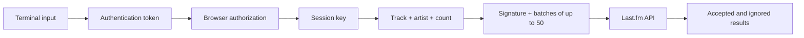

<p align="center">
  <strong>English</strong> · <a href="README.pt-BR.md">Português (Brasil)</a> · <a href="README.es-ES.md">Español (España)</a>
</p>

<p align="center">
  
</p>

<h1 align="center">Scrobblez</h1>
<p align="center">A TypeScript CLI for exploring authentication and batched scrobble requests with the Last.fm API.</p>

<p align="center">
  <a href="https://github.com/mwistro/Scrobblez/actions/workflows/ci.yml"></a>
  
  
  <a href="LICENSE"></a>
</p>

<p align="center">
  <a href="#demo">Demo</a> · <a href="#run-locally">Run locally</a> · <a href="#how-it-works">How it works</a> · <a href="#current-scope">Current scope</a>
</p>

## At a glance

Scrobblez is a learning project about integrating APIs from the terminal. Its workflow brings together browser authorization, request signing, interactive input and per-batch result reporting.

A *scrobble* is a playback record submitted to Last.fm. This project uses manual input and generated timestamps; it does not monitor what is playing. The offline demo lets you explore the flow without an account.

| Capability | Implementation |
| --- | --- |
| Authentication | Requests a token, opens browser authorization and obtains a session. |
| Interactive input | Accepts `track - artist` or prompts for the artist separately. |
| Batch submission | Splits the requested count into requests of up to 50 records. |
| Visible results | Shows progress with separate accepted and ignored counts. |
| Offline demo | Runs the same workflow with simulated responses, without networking or credentials. |

## Demo


*Terminal preview rendered from the actual demo output. Last.fm responses are simulated: no scrobbles were submitted. The terminal interface is in English.*

The demo uses `Midnight City - M83` and 55 fictional records to show two batches: 50 + 5. Read the [full text transcript](docs/assets/demo.txt).

## Run locally

### Try it without an account

Requirements: **Node.js 22 or newer**, npm and Git. Continuous integration checks Node.js 22 and 24.

```bash
git clone https://github.com/mwistro/Scrobblez.git
cd Scrobblez
npm ci
npm run demo
```

This command compiles TypeScript and runs a scripted demo session. It does not read `.env`, open a browser or make network requests. Installing dependencies requires internet access.

### Connect to Last.fm

Live mode submits records to your account. The current implementation generates timestamps at five-minute intervals going backwards from the time of execution; it does not recover actual playback times. Read the [current scope](#current-scope) before using this mode.

1. Create credentials on the [Last.fm application page](https://www.last.fm/api/account/create).
2. Copy [`.env.example`](.env.example) to `.env` **in the repository root** and fill in both fields:

   ```dotenv
   LASTFM_API_KEY=your_api_key
   LASTFM_SHARED_SECRET=your_shared_secret
   ```

3. Build and start from the repository root:

   ```bash
   npm run build
   npm start
   ```

4. Authorize the application in your browser, then return to the terminal and press Enter.
5. Enter `track - artist` (with spaces around the hyphen), or enter just the track to be prompted for the artist. Then enter a positive whole-number count.
6. Review the results. Answer `y` to continue or `n` to exit.

Git ignores `.env`. The session stays in memory only; each new run requires authorization.

## How it works



Requests are signed with the shared secret. Submissions use form-encoded `POST` requests; the summary reads the counts returned by the API. References: [desktop authentication](https://www.last.fm/api/desktopauth) and [`track.scrobble`](https://www.last.fm/api/show/track.scrobble).

In demo mode, responses and input are scripted, and browser launching is disabled. The remaining workflow still uses the CLI's functions.

## Stack and structure

| Layer | Technology |
| --- | --- |
| Language and runtime | TypeScript, Node.js and ESM modules |
| Interface | `node:readline` |
| HTTP and browser | `node-fetch`, `open` |
| Configuration and signing | `dotenv`, `node:crypto` |
| Validation | Node.js test runner, TypeScript compiler and GitHub Actions |

```text
src/
  main.ts       # Authentication, prompts and batch submission
  protocol.ts   # Signing and API count validation
  demo.ts       # Offline demo responses and input
  types.ts      # Last.fm response types
tests/          # Protocol and CLI execution tests
docs/assets/    # Terminal preview and transcript
.env.example    # Local configuration template
```

## Checks

```bash
npm run check
npm test
```

Tests cover signed parameter ordering, accepted and ignored counts, malformed responses, missing credentials and the demo with network access blocked. CI also runs the demo. Automated tests do not access a live Last.fm account.

## Current scope

- **Learning project:** manual entry of one track at a time, repeated for the chosen count. No player integration or playback detection.
- **Generated timestamps:** fixed five-minute intervals, with no history import or input for actual playback times. Use the demo to explore the project without changing your listening history.
- **No persistence:** no database, stored sessions or batch resumption.
- **Failure handling:** errors stop the remaining batches and return a nonzero exit code. Ignored records also result in a nonzero exit code. There are no automatic retries; check your history before trying again.
- **Documentation in three languages:** English, Brazilian Portuguese and Spanish from Spain. CLI messages are in English.

## Author and license

Created by [Mateus Maistro](https://github.com/mwistro). Distributed under the [MIT License](LICENSE).

Independent project, not affiliated with Last.fm.
