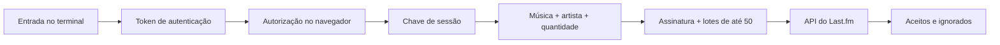

<p align="center">
  <a href="README.md">English</a> · <strong>Português (Brasil)</strong> · <a href="README.es-ES.md">Español (España)</a>
</p>

<p align="center">
  
</p>

<h1 align="center">Scrobblez</h1>
<p align="center">Uma CLI em TypeScript para explorar autenticação e envio de scrobbles em lotes com a API do Last.fm.</p>

<p align="center">
  <a href="https://github.com/mwistro/Scrobblez/actions/workflows/ci.yml"></a>
  
  
  <a href="LICENSE"></a>
</p>

<p align="center">
  <a href="#demonstração">Demonstração</a> · <a href="#executar-localmente">Executar localmente</a> · <a href="#como-funciona">Como funciona</a> · <a href="#escopo-atual">Escopo atual</a>
</p>

## Visão geral

O Scrobblez é um projeto de estudo sobre integração com APIs a partir do terminal. O fluxo reúne autorização no navegador, assinatura de requisições, entrada interativa e acompanhamento dos resultados de cada lote.

Um *scrobble* é um registro de reprodução enviado ao Last.fm. Este projeto trabalha com entradas manuais e horários gerados; ele não monitora o que está tocando. A demonstração offline permite conhecer o fluxo sem usar uma conta.

| Recurso | Implementação |
| --- | --- |
| Autenticação | Solicita um token, abre a autorização no navegador e obtém uma sessão. |
| Entrada interativa | Aceita `música - artista` ou solicita o artista separadamente. |
| Envio em lotes | Divide a quantidade informada em requisições de até 50 registros. |
| Resultados visíveis | Exibe progresso e contagens separadas de aceitos e ignorados. |
| Demo offline | Executa o mesmo fluxo com respostas simuladas, sem rede nem credenciais. |

## Demonstração


*Prévia renderizada a partir da saída real do modo demo. As respostas do Last.fm são simuladas: nenhum scrobble foi enviado. A interface do terminal permanece em inglês.*

A demo usa `Midnight City - M83` e 55 registros fictícios para mostrar a divisão em dois lotes: 50 + 5. Confira a [saída completa em texto](docs/assets/demo.txt).

## Executar localmente

### Experimentar sem uma conta

Requisitos: **Node.js 22 ou superior**, npm e Git. A integração contínua verifica as versões 22 e 24 do Node.js.

```bash
git clone https://github.com/mwistro/Scrobblez.git
cd Scrobblez
npm ci
npm run demo
```

Esse comando compila o TypeScript e executa uma sessão demonstrativa. Não lê o `.env`, não abre o navegador e não faz requisições de rede. A instalação das dependências requer internet.

### Conectar ao Last.fm

O modo conectado envia registros para sua conta. A implementação atual gera horários com intervalos de cinco minutos retrocedendo a partir do momento da execução; ela não recupera horários reais de reprodução. Veja o [escopo atual](#escopo-atual) antes de usar esse modo.

1. Crie suas credenciais na [página de aplicações do Last.fm](https://www.last.fm/api/account/create).
2. Copie [`.env.example`](.env.example) para `.env` **na raiz do repositório** e preencha os dois campos:

   ```dotenv
   LASTFM_API_KEY=your_api_key
   LASTFM_SHARED_SECRET=your_shared_secret
   ```

3. Compile e execute a partir da raiz:

   ```bash
   npm run build
   npm start
   ```

4. Autorize o aplicativo no navegador e volte ao terminal para pressionar Enter.
5. Informe `música - artista` (com espaços ao redor do hífen), ou apenas a música para receber a pergunta sobre o artista. Depois, informe uma quantidade inteira positiva.
6. Confira os resultados. Responda `y` para continuar ou `n` para sair.

O `.env` é ignorado pelo Git. A sessão fica apenas na memória; uma nova execução exige nova autorização.

## Como funciona



As requisições são assinadas com o segredo compartilhado. O envio usa `POST` com dados de formulário; o resumo lê as contagens devolvidas pela API. Referências: [autenticação desktop](https://www.last.fm/api/desktopauth) e [`track.scrobble`](https://www.last.fm/api/show/track.scrobble).

Na demo, as respostas e as entradas são predefinidas, e a abertura do navegador é desativada. O restante do fluxo continua usando as funções da CLI.

## Tecnologias e organização

| Camada | Tecnologia |
| --- | --- |
| Linguagem e execução | TypeScript, Node.js e módulos ESM |
| Interface | `node:readline` |
| HTTP e navegador | `node-fetch`, `open` |
| Configuração e assinatura | `dotenv`, `node:crypto` |
| Validação | Test runner do Node.js, compilador TypeScript e GitHub Actions |

```text
src/
  main.ts       # Autenticação, perguntas e envio em lotes
  protocol.ts   # Assinatura e validação das contagens da API
  demo.ts       # Respostas e entradas da demo offline
  types.ts      # Tipos das respostas do Last.fm
tests/          # Testes de protocolo e execução da CLI
docs/assets/    # Prévia do terminal e transcrição
.env.example    # Modelo de configuração local
```

## Verificações

```bash
npm run check
npm test
```

Os testes cobrem a ordenação dos parâmetros assinados, contagens de aceitos e ignorados, respostas inválidas, ausência de credenciais e a demo com acesso à rede bloqueado. O CI também executa a demonstração. Os testes automatizados não acessam uma conta real do Last.fm.

## Escopo atual

- **Projeto de estudo:** entrada manual de uma música por vez, repetida pela quantidade escolhida. Sem integração com players ou detecção de reprodução.
- **Horários gerados:** intervalos fixos de cinco minutos; sem importação de histórico nem campo para informar os horários reais. Use a demo para explorar o projeto sem alterar seu histórico.
- **Sem persistência:** não há banco de dados, armazenamento de sessão ou retomada de lotes.
- **Tratamento de falhas:** um erro interrompe os lotes restantes e encerra com código diferente de zero. Registros ignorados também resultam em código diferente de zero. Não há repetição automática; confira o histórico antes de tentar novamente.
- **Documentação em três idiomas:** inglês, português do Brasil e espanhol da Espanha. As mensagens da CLI estão em inglês.

## Autor e licença

Criado por [Mateus Maistro](https://github.com/mwistro). Distribuído sob a [licença MIT](LICENSE).

Projeto independente, sem afiliação com o Last.fm.
